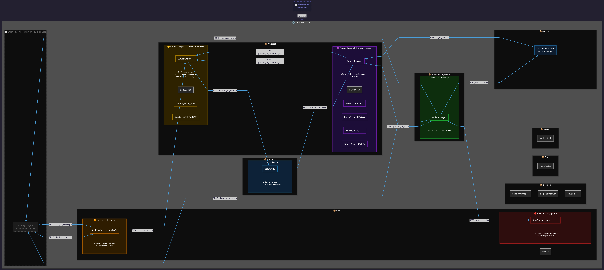

# Architecture

[Architecture Diagram](../assets/architecture.png){target="_blank"}

## Architecture Decision

**Unified dispatch over per-protocol pipelines** — Parser and builder dispatch units handle all protocol/venue combinations (FIX, OUCH BIST, OUCH NASDAQ, ITCH BIST, ITCH NASDAQ) within a single thread each. The target hardware has 10 cores / 16 threads; each main pipeline stage is pinned to a dedicated core, leaving no headroom for per-protocol pipelines under normal load. Per-protocol class boundaries are kept clean so splitting into independent pipelines later requires minimal structural change.

## Threading Model

Each component is pinned to a dedicated physical core with 
SCHED_FIFO to eliminate scheduling jitter.

| Component | Core | Thread | Policy | Priority |
|-----------|------|--------|--------|----------|
| Network Rx/Tx | P-core 1 | Thread 0 | SCHED_FIFO | max |
| Parser | P-core 2 | Thread 2 | SCHED_FIFO | max |
| Order Manager | P-core 3 | Thread 4 | SCHED_FIFO | max |
| Strategy | P-core 4 | Thread 6 | SCHED_FIFO | max |
| Builder | P-core 5 | Thread 8 | SCHED_FIFO | max |
| Risk Update | P-core 6 | Thread 10 | SCHED_FIFO | max |
| Risk Check | E-core 7 | Thread 12 | SCHED_FIFO | max |
| Database | E-core 8 | Thread 13 | SCHED_FIFO | max/2 |
| Main | E-core 9 | Thread 14 | SCHED OTHER | default |

### Network Design Decision

Network Rx and Tx share a single thread on one P-core. 
Separating them would require dedicating an additional 
P-core to Tx — given the limited P-core count, the same 
loop handles both directions. E-cores were not considered 
for network due to their lower single-thread performance 
and cache characteristics.

### Risk Check Design Decision

Risk Check is read-heavy — it validates positions and limits 
without mutating state. With P-cores fully allocated to 
latency-critical write path components, Risk Check was 
assigned to an E-core. Its read-only nature makes it 
tolerant of the lower single-thread throughput of E-cores.

## Source Structure

| Module | File | Purpose |
|--------|------|---------|
| **src** | `TradingEngine.h/cpp` | Engine entry point, thread orchestration |
| **src** | `main.cpp` | Application entry point |
| **core** | `Order.h` | Core order data structure |
| **core** | `HashTables.h/cpp` | Symbol lookup and exec ID dedup |
| **core** | `MessagePool.h` | Preallocated message pool |
| **core** | `MessageWithVenue.h` | Venue-tagged message wrapper |
| **core** | `Protocol-Venue.h` | Protocol and venue enums |
| **database** | `ClickhouseWriter.h/cpp` | Async trade/order logging to ClickHouse *(not finished)* |
| **database** | `DbTypes.h` | Database type definitions |
| **flows** | `BuilderFlow.h/cpp` | Builder thread loop |
| **flows** | `NetworkFlow.h/cpp` | Network thread loop |
| **flows** | `OrderFlow.h/cpp` | OrderManager thread loop |
| **flows** | `ParserFlow.h/cpp` | Parser thread loop |
| **flows** | `RiskFlow.h/cpp` | Risk thread loop |
| **market** | `MarketBook.h/cpp` | Aggregated order book, atomic best bid/ask |
| **network** | `NetworkIO.h/cpp` | epoll-based non-blocking socket I/O |
| **network** | `NetworkPackets.h` | Packet buffer definitions |
| **network** | `NetworkPendingQueue.h` | Pending packet queue |
| **order_management** | `OrderManager.h/cpp` | Order state management |
| **order_management/fillers** | `FillerFIX.h/cpp` | FIX order fill handler |
| **order_management/fillers** | `FillerITCH_BIST.h/cpp` | ITCH BIST order fill handler |
| **order_management/fillers** | `FillerITCH_NASDAQ.h/cpp` | ITCH NASDAQ order fill handler |
| **order_management/fillers** | `FillerOUCH_BIST.h/cpp` | OUCH BIST order fill handler |
| **order_management/fillers** | `FillerOUCH_NASDAQ.h/cpp` | OUCH NASDAQ order fill handler |
| **protocol** | `Builder_Dispatch.h/cpp` | Builder dispatch and routing |
| **protocol** | `Parser_Dispatch.h/cpp` | Parser dispatch and routing |
| **protocol/builders/FIX** | `Builder_FIX.h/cpp` | FIX 5.0 message serializer |
| **protocol/builders/OUCH** | `Builder_OUCH_BIST.h/cpp` | OUCH BIST message serializer |
| **protocol/builders/OUCH** | `Builder_OUCH_NASDAQ.h/cpp` | OUCH NASDAQ message serializer |
| **protocol/parsers/FIX** | `Parser_FIX.h/cpp` | FIX 5.0 message deserializer |
| **protocol/parsers/ITCH** | `Parser_ITCH_BIST.h/cpp` | ITCH BIST message deserializer |
| **protocol/parsers/ITCH** | `Parser_ITCH_NASDAQ.h/cpp` | ITCH NASDAQ message deserializer |
| **protocol/parsers/OUCH** | `Parser_OUCH_BIST.h/cpp` | OUCH BIST message deserializer |
| **protocol/parsers/OUCH** | `Parser_OUCH_NASDAQ.h/cpp` | OUCH NASDAQ message deserializer |
| **protocol/types** | `FIXMessage.h` | FIX message type definitions |
| **protocol/types** | `ITCHTypes_BIST.h` | ITCH BIST type definitions |
| **protocol/types** | `ITCHTypes_NASDAQ.h` | ITCH NASDAQ type definitions |
| **protocol/types** | `OUCHTypes_BIST.h` | OUCH BIST type definitions |
| **protocol/types** | `OUCHTypes_NASDAQ.h` | OUCH NASDAQ type definitions |
| **risk** | `RiskEngine.h/cpp` | Pre/post trade risk evaluation |
| **risk** | `Limits.h/cpp` | Risk limit configuration |
| **session** | `SessionManager.h/cpp` | Connection and login state |
| **session** | `LoginController.h/cpp` | Login sequence management |
| **session** | `SoupBinTcp.h/cpp` | SBT session layer |
| **session** | `Sequence_FIX.h` | FIX sequence tracking |
| **session** | `Sequence_SBT.h` | SBT sequence tracking |
| **utils** | `Logger.h/cpp` | spdlog-based logging |
| **utils** | `ErrorHandler.h/cpp` | Error handling and recovery |
| **utils** | `Endian.h` | Byte order utilities |
| **utils** | `common.h` | Shared constants and macros |
| **utils** | `config_utils.h/cpp` | Config loading utilities |

## Automated Compenents

| Module | File | Purpose |
|--------|------|---------|
| **generated** | `GeneratedITCHMessages_BIST.h` | Code-generated ITCH BIST messages |
| **generated** | `GeneratedITCHMessages_NASDAQ.h` | Code-generated ITCH NASDAQ messages |
| **generated** | `GeneratedOUCHMessages_BIST.h` | Code-generated OUCH BIST messages |
| **generated** | `GeneratedOUCHMessages_NASDAQ.h` | Code-generated OUCH NASDAQ messages |
| **generated** | `GeneratedSymbolTables.h` | Code-generated symbol tables |
| **generated** | `GeneratedErrorMap.h` | Code-generated error map |

## Infrastructure & Tooling

| Module | File | Purpose |
|--------|------|---------|
| **config** | `Limits.json` | Risk limits per venue and symbol |
| **config** | `Sessions.json` | Session configuration |
| **scripts/tools/codegen** | `GenerateITCHMessages_BIST.py` | ITCH BIST message type generator |
| **scripts/tools/codegen** | `GenerateITCHMessages_NASDAQ.py` | ITCH NASDAQ message type generator |
| **scripts/tools/codegen** | `GenerateOUCHMessages_BIST.py` | OUCH BIST message type generator |
| **scripts/tools/codegen** | `GenerateOUCHMessages_NASDAQ.py` | OUCH NASDAQ message type generator |
| **scripts/tools/codegen** | `GenerateSymbolTables.py` | Symbol table generator |
| **scripts/test** | `run_all_unit_test.sh`| Run all unit tests |
| **scripts/test** | `run_all_bench_test.sh`| Run all benchmarks |
| **scripts/test** | `run_all_perf_test.sh` | Run all perf tests |
| **scripts/test** | `run_all_pipeline_test.sh` | Run all pipeline tests |
| **scripts/test** | `run_all_test.sh` | Run all tests |
| **test/unit** | — | Unit tests (gtest) |
| **test/benchmark** | — | Google Benchmark latency tests |
| **test/perf** | — | Performance stat profiling targets (perf) |
| **test/pipeline** | — | End-to-end pipeline tests |
| **test/data** | — | Test datasets |
